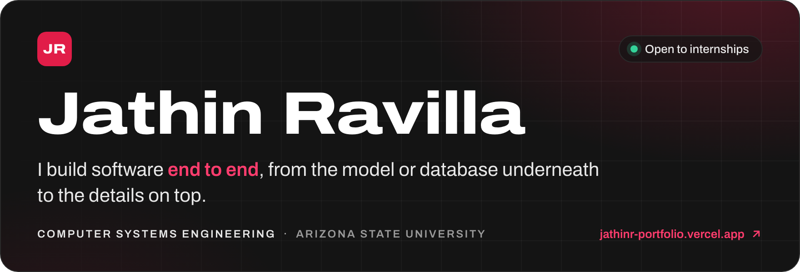
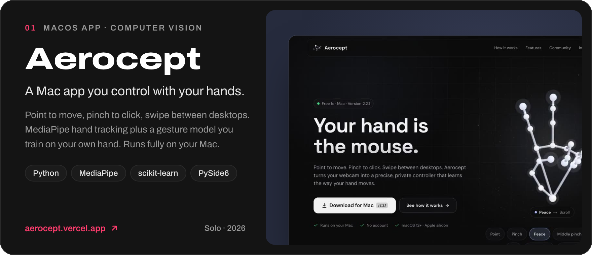
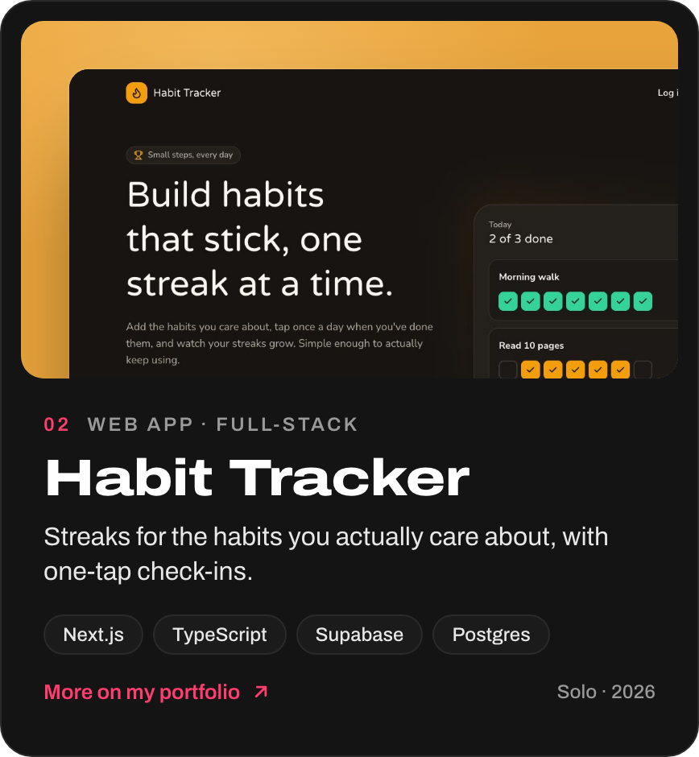
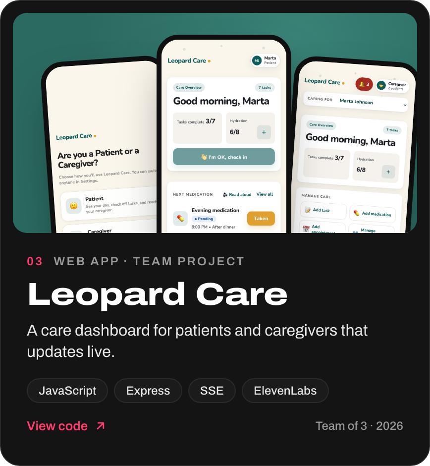
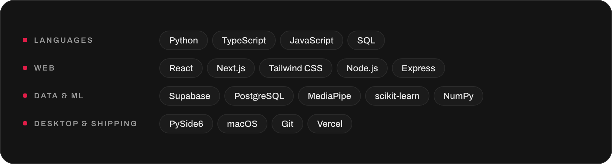
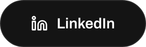
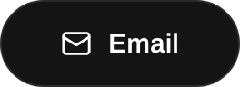

 

I'm a second-year Computer Systems Engineering student at Arizona State University. I like taking an idea all the way, from an empty folder to an app people can download, sign up for, or use with their family.

Lately that means full-stack web apps on Next.js and Supabase, and on-device machine learning for macOS.

### Selected work

&nbsp;

Most of my code lives in private repos. My <a href="https://jathinr-portfolio.vercel.app">portfolio</a> has more on each project, and I'm happy to walk through any of it.

### Toolbox

### Get in touch

&nbsp;&nbsp;
