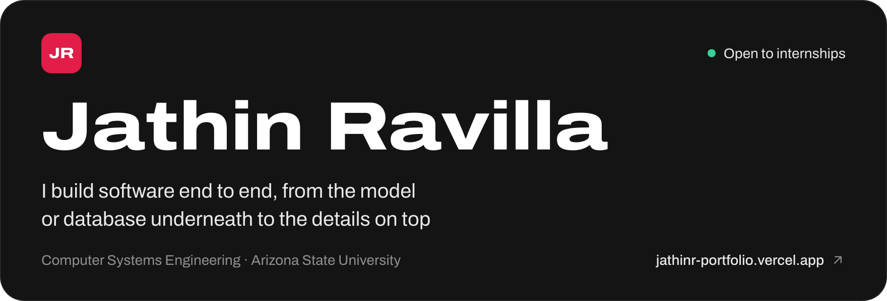
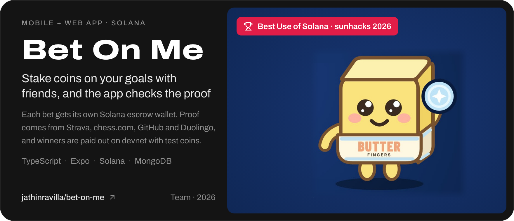
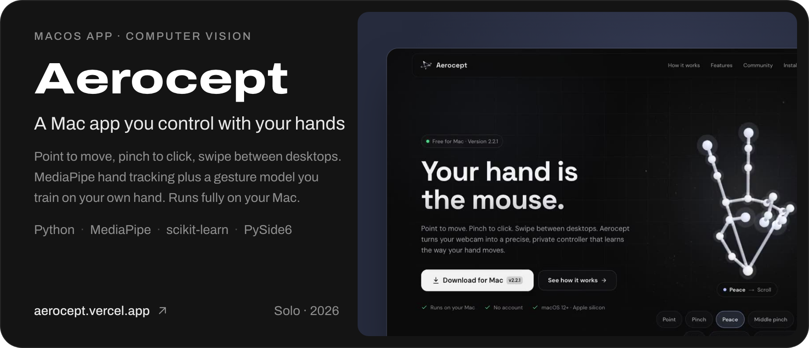
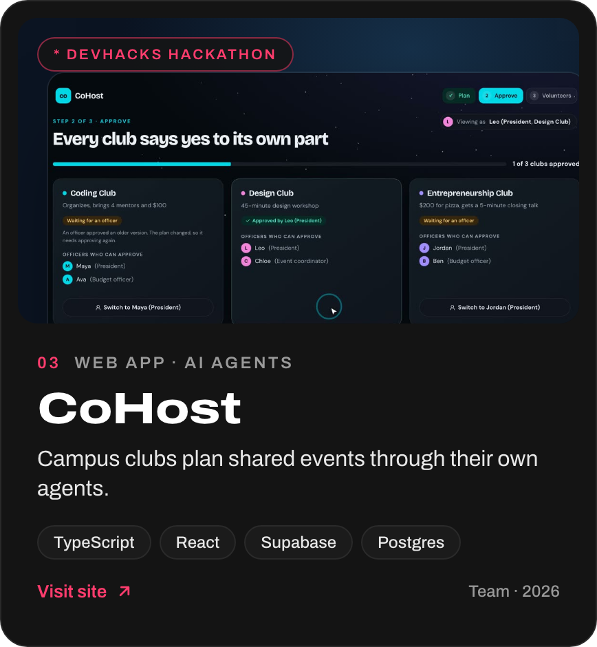
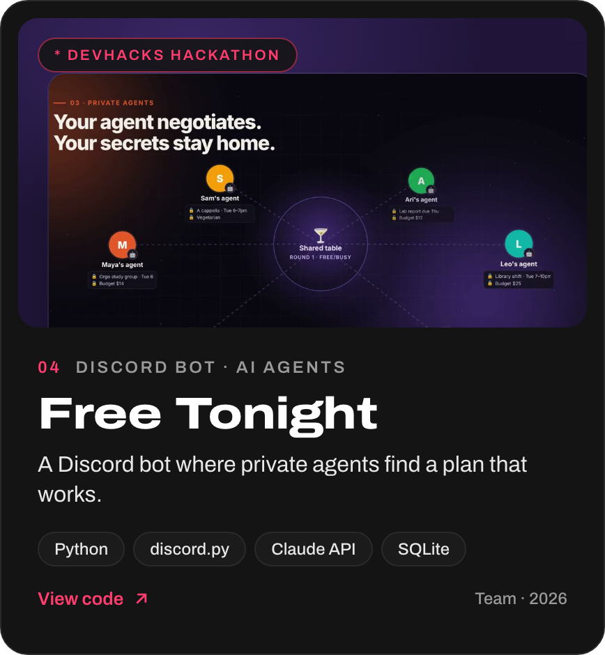
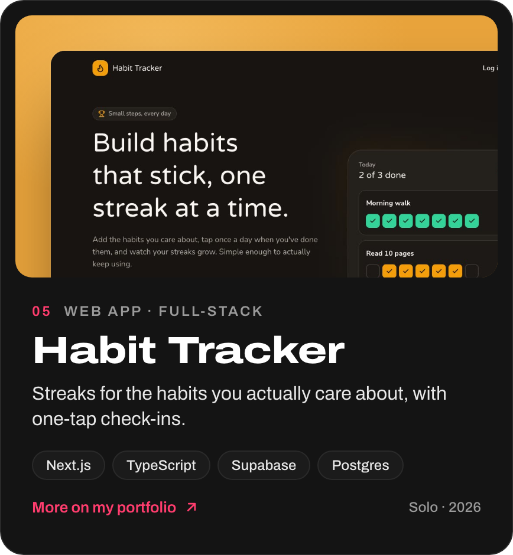
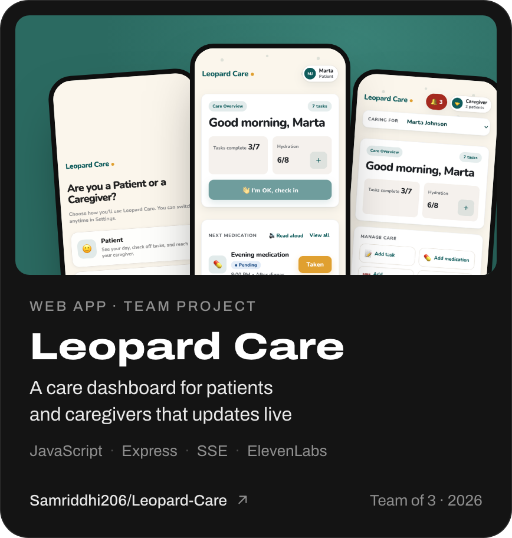

<a href="https://jathinr-portfolio.vercel.app">
<picture>
<source media="(max-width: 600px)" srcset="https://raw.githubusercontent.com/jathinravilla/jathinravilla/main/assets/banner-phone.png">

</picture>
</a>

I'm a second-year Computer Systems Engineering student at Arizona State University. I like taking an idea all the way, from an empty folder to an app people can download, sign up for, or use with their family.

Lately that means full-stack web apps on Next.js and Supabase, and on-device machine learning for macOS.

Most recently, my team's app [Bet On Me](https://github.com/jathinravilla/bet-on-me) won Best Use of Solana (MLH) at sunhacks 2026.

### Selected work

<a href="https://github.com/jathinravilla/bet-on-me">
<picture>
<source media="(max-width: 600px)" srcset="https://raw.githubusercontent.com/jathinravilla/jathinravilla/main/assets/bet-on-me-phone.png">

</picture>
</a>

<a href="https://aerocept.vercel.app">
<picture>
<source media="(max-width: 600px)" srcset="https://raw.githubusercontent.com/jathinravilla/jathinravilla/main/assets/aerocept-phone.png">

</picture>
</a>

<a href="https://cohost-redesign.vercel.app">
<picture>
<source media="(max-width: 600px)" srcset="https://raw.githubusercontent.com/jathinravilla/jathinravilla/main/assets/cohost-phone.png">

</picture>
</a>
<a href="https://github.com/jathinravilla/free-tonight">
<picture>
<source media="(max-width: 600px)" srcset="https://raw.githubusercontent.com/jathinravilla/jathinravilla/main/assets/free-tonight-phone.png">

</picture>
</a>

<a href="https://jathinr-portfolio.vercel.app">
<picture>
<source media="(max-width: 600px)" srcset="https://raw.githubusercontent.com/jathinravilla/jathinravilla/main/assets/habit-tracker-phone.png">

</picture>
</a>
<a href="https://github.com/Samriddhi206/Leopard-Care">
<picture>
<source media="(max-width: 600px)" srcset="https://raw.githubusercontent.com/jathinravilla/jathinravilla/main/assets/leopard-care-phone.png">

</picture>
</a>

Bet On Me (sunhacks 2026), CoHost and Free Tonight (DevHacks, Cubbie theme) are hackathon builds. Most of my code lives in private repos. My <a href="https://jathinr-portfolio.vercel.app">portfolio</a> has more on each project, and I'm happy to walk through any of it.

### Toolbox

**Languages** &nbsp;Python · TypeScript · JavaScript · SQL 
**Web** &nbsp;React · Next.js · Tailwind CSS · Node.js · Express 
**Data and ML** &nbsp;Supabase · PostgreSQL · MediaPipe · scikit-learn · NumPy 
**Desktop and shipping** &nbsp;PySide6 · macOS · Git · Vercel

### Get in touch

[Portfolio](https://jathinr-portfolio.vercel.app) &nbsp;·&nbsp; [LinkedIn](https://www.linkedin.com/in/jathin-ravilla/) &nbsp;·&nbsp; [Email](mailto:jcravilla@gmail.com)
